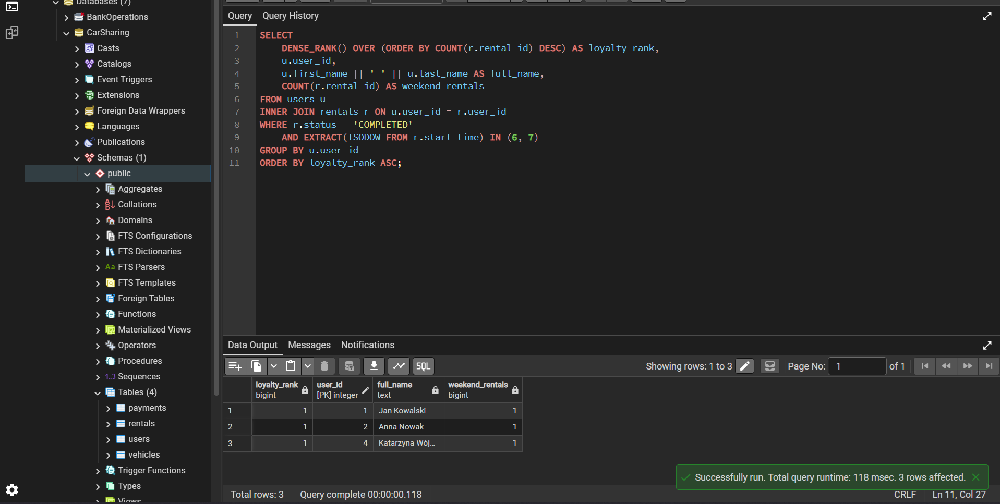

### Raport 2: Segmentacja klientów weekendowych (Program lojalnościowy)

**Problem biznesowy:**
Dział marketingu chce uruchomić program lojalnościowy i nagrodzić klientów, którzy najczęściej korzystają z naszych usług w weekendy. Potrzebujemy rankingu użytkowników posortowanych według liczby pomyślnie zrealizowanych przejazdów, które zostały jednoznacznie zainicjowane w weekend. Chcemy przypisać im wyraźne pozycje w rankingu (1, 2, 3...).

**Zapytanie SQL:**
```sql
SELECT 
    v.brand || ' ' || v.model AS vehicle, 
    v.category,
    SUM(p.amount) AS total_amount,
    SUM(r.distance_km) AS total_distance,
    ROUND(SUM(p.amount) / NULLIF(SUM(r.distance_km), 0), 2) AS amount_per_distance
FROM vehicles v
INNER JOIN rentals r ON v.vehicle_id = r.vehicle_id
INNER JOIN payments p ON p.rental_id = r.rental_id
WHERE p.payment_status = 'PAID'
    AND r.status = 'COMPLETED'
GROUP BY v.category, vehicle
ORDER BY amount_per_distance DESC;
```

**Kluczowe decyzje analityczne:**
*   **Zabezpieczenie przed Division by Zero:** Zastosowano funkcję `NULLIF(SUM(r.distance_km), 0)`. W przypadku awarii modułu GPS sprzętu (dystans = 0), skrypt nie wywoła błędu krytycznego silnika, lecz zwróci wartość NULL.
*   **Filtrowanie statusów transakcyjnych:** Ograniczono zbiór wyłącznie do przejazdów fizycznie zrealizowanych (`COMPLETED`) i skutecznie opłaconych (`PAID`), odrzucając szum informacyjny z porzuconych rezerwacji.
*   **Optymalizacja pod kątem biznesu:** Zastosowano konkatenację (`||`), łącząc markę i model w jedną kolumnę `vehicle` dla łatwiejszej interpretacji raportu.

**Wynik działania skryptu (Output):**


