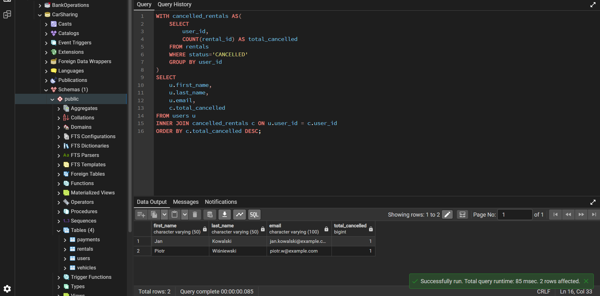

### Raport 3: "Czarna lista" użytkowników (Wskaźnik anulacji)

**Problem biznesowy:**
Dział operacyjny chce zidentyfikować klientów, którzy anulowali przynajmniej jedną rezerwację. Potrzebujemy ich danych kontaktowych (imię, nazwisko, email) oraz dokładnej liczby ich anulacji, aby wysłać im maila z upomnieniem. Zestawienie powinno pokazywać tylko tych, którzy mają na koncie anulacje, od największej ich liczby.

**Zapytanie SQL:**
```sql
WITH cancelled_rentals AS(
    SELECT
        user_id,
        COUNT(rental_id) AS total_cancelled
    FROM rentals
    WHERE status='CANCELLED'
    GROUP BY user_id
)
SELECT
    u.first_name,
    u.last_name,
    u.email,
    c.total_cancelled
FROM users u
INNER JOIN cancelled_rentals c ON u.user_id = c.user_id
ORDER BY c.total_cancelled DESC;
```

**Kluczowe decyzje analityczne:**
*   **Wykorzystanie CTE (Common Table Expressions):** Zamiast obciążać główne zapytanie logiką filtrującą i grupującą, zastosowano klauzulę `WITH`. Wyizolowanie agregacji anulacji do tabeli tymczasowej (`cancelled_rentals`) znacząco zwiększa czytelność kodu.
*   **Wydajne filtrowanie na wczesnym etapie:** Filtrowanie `status = 'CANCELLED'` zachodzi wewnątrz CTE, zanim dojdzie do łączenia (`JOIN`) z tabelą użytkowników. Dzięki temu do głównego zapytania trafia wyłącznie mały zbiór problematycznych klientów, co optymalizuje czas wykonania.
*   **Zliczanie po kluczu głównym:** Do wyliczenia anulacji wykorzystano `COUNT(rental_id)` zamiast zliczania wierszy. Odwołanie się bezpośrednio do klucza głównego gwarantuje brak wartości `NULL` i zapewnia precyzję matematyczną raportu.

**Wynik działania skryptu (Output):**

